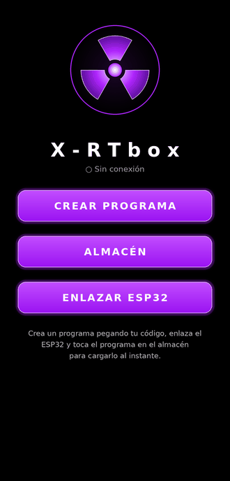

# X-RTbox · programa tu ESP32 desde el móvil

App Android + firmware para ESP32. Pegas tu código C++ de Arduino en el móvil, lo guardas, y con un toque se ejecuta en el ESP32 por **Bluetooth** o por **cable USB‑C**, sin PC ni recompilar.

<p align="center"></p>

```
 MÓVIL (app X-RTbox)                         ESP32 (firmware X-RTbox)
 ┌──────────────────┐  Bluetooth LE      ┌──────────────────────────────┐
 │ CREAR PROGRAMA   │  o cable USB-C     │ recibe el código              │
 │ ALMACÉN  (toque) │ ─────────────────► │ lo guarda en su memoria       │
 │ ENLAZAR ESP32    │ ◄───────────────── │ lo ejecuta con el intérprete  │
 │ consola          │   Serial.print     │ MiniC (C++ estilo Arduino)    │
 └──────────────────┘                    └──────────────────────────────┘
```

**Por qué un intérprete:** el ESP32 no puede compilar C++ por sí mismo, así que el firmware lleva **MiniC**, un intérprete del C++ típico de Arduino que ejecuta tu programa al instante. El firmware se instala **una sola vez**, y lo puede hacer la propia app por USB‑C.

---

## Contenido

| Carpeta | Qué es |
|---|---|
| `esp32/XRTboxESP32/` | Firmware del ESP32: `XRTboxESP32.ino`, `MiniC.h`, `MiniC.cpp` |
| `android/` | App Android (Java, sin librerías externas) |
| `.github/workflows/compilar.yml` + `herramientas/` | Compila el firmware y el APK en GitHub y publica el enlace de descarga |
| `ejemplos/` | Programas de ejemplo listos para pegar en la app |

---

## Paso 1 · Conseguir el APK (descarga directa)

GitHub compila la app gratis y te da un **enlace fijo para descargar el APK desde el móvil**. Además mete dentro de la app el firmware para ESP32, ESP32‑S3, ESP32‑C3 y ESP32‑C6, que necesita el botón *Instalar firmware*.

1. Crea una cuenta en github.com y un repositorio nuevo, por ejemplo `x-rtbox`. Si es **público**, el enlace funciona en cualquier navegador. Si es privado, tienes que tener la sesión de GitHub iniciada en el móvil.
2. Pulsa **"uploading an existing file"**, arrastra **todo el contenido** de la carpeta `X-RTbox` (incluida la carpeta `.github`) y pulsa *Commit changes*.
   - Si tu ordenador oculta `.github` y no se sube, créalo a mano: *Add file → Create new file*, escribe como nombre `.github/workflows/compilar.yml` y pega el contenido de ese archivo (ábrelo con el Bloc de notas).
3. En la pestaña **Actions** verás *Compilar X-RTbox* en marcha (unos 10 minutos la primera vez). Si no arranca, entra y pulsa *Run workflow*.
4. Cuando acabe en verde, abre en el móvil:
   **`https://github.com/TU_USUARIO/x-rtbox/releases/latest/download/X-RTbox.apk`**
   (también lo tienes en la pestaña *Releases* del repositorio). Cada vez que cambies algo, el enlace se actualiza solo.
5. Al abrir el APK, Android pedirá permitir **"instalar apps desconocidas"**. Requiere Android 8.0 o superior.

> Alternativa: compilar con **Android Studio** (*File → Open →* carpeta `android`, *Build → Build APK*). Ese APK no lleva el firmware dentro, a menos que antes copies los `.bin` en `android/app/src/main/assets/firmware/`.

---

## Paso 2 · Poner el firmware en el ESP32 (una sola vez)

### Opción A · Desde el móvil, sin PC (recomendada)

1. Conecta el ESP32 al **USB‑C del móvil**. Vale un cable USB‑C a USB‑C, o un adaptador OTG + el cable de tu placa si es micro‑USB. Tiene que ser un cable de datos: los que solo cargan no sirven.
2. Android preguntará si quieres abrir X-RTbox: di que sí.
3. En **ENLAZAR ESP32** pulsa **⚡ INSTALAR FIRMWARE BLUETOOTH**. La app detecta el chip, lo pone en modo programación y graba el firmware (entre 30 segundos y 2 minutos). El logo gira y se ve el porcentaje.
4. Si dice que no entra en modo programación: mantén pulsado **BOOT**, pulsa y suelta **RST/EN**, suelta **BOOT** y vuelve a intentarlo.

Chips compatibles: ESP32, ESP32‑S3, ESP32‑C3 y ESP32‑C6. El **ESP32‑S2 no tiene Bluetooth** y no sirve. Adaptadores USB compatibles: CP210x, CH340/CH341/CH9102/CH343 y el USB nativo de los S3/C3/C6.

### Opción B · Con el Arduino IDE

1. En *Herramientas → Placa → Gestor de placas*, instala **esp32** de Espressif **versión 3.3.x**. La 4.0, aún en pruebas, cambió la librería Bluetooth y el firmware te avisará si la tienes.
2. Abre `esp32/XRTboxESP32/XRTboxESP32.ino`, elige tu placa y en *Partition Scheme* pon **Huge APP (3MB No OTA/1MB SPIFFS)**. En S3/C3/C6 activa también *USB CDC On Boot → Enabled* si vas a usar el cable del USB nativo.
3. Pulsa **Subir**. En el Monitor Serie (115200) verás `[X-RTbox] Bluetooth listo: X-RTbox-A1B2`.

---

## Paso 3 · Usar la app

1. **ENLAZAR ESP32**, en *Conectar por*:
   - **BLUETOOTH**: busca y toca tu `X-RTbox-XXXX`. La próxima vez se reconecta sola al abrir la app.
   - **USB‑C**: con el ESP32 enchufado al móvil. Al enchufarlo, Android ya te ofrece abrir la app y enlazar.
2. **CREAR PROGRAMA** → ponle nombre → *PEGAR* tu código (o *PLANTILLA* para un ejemplo) → *GUARDAR*, o *GUARDAR Y CARGAR* para mandarlo ya.
3. **ALMACÉN** → **toca un programa y se carga al instante**. Mantén pulsado para editar, renombrar, compartir o eliminar. *IMPORTAR* trae archivos `.ino`/`.cpp`.
   - **Consola:** muestra lo que imprime tu programa con `Serial.print`. Con *ENVIAR* le mandas texto, que lee con `Serial.readStringUntil('\n')`, `Serial.read()`, etc.
   - **■ DETENER** para el programa y deja los pines en reposo. **▶ REINICIAR** lo vuelve a ejecutar desde `setup()`.
   - Si hay un error, la app te dice la línea y te lleva al editor con *IR A LA LÍNEA*.

El **logo de radiactividad gira** mientras la app trabaja (buscando, conectando, cargando, instalando firmware…) y se queda quieto al terminar.

El ESP32 **recuerda el último programa** y lo ejecuta solo al encenderse. Si un programa da problemas, enciende el ESP32 con **BOOT** pulsado y arrancará sin ejecutarlo.

**Placas con dos conectores (S3/C3):** para enlazar por cable usa el marcado **USB** (el nativo). Para instalar el firmware vale cualquiera de los dos.

---

## Qué C++ entiende el intérprete

**Sí:**
- `setup()` y `loop()`, funciones propias (con recursión, parámetros por referencia `int &x` y valores por defecto), prototipos
- Tipos: `int`, `long`, `unsigned long`, `byte`, `bool`, `char`, `float`, `double`, `uint8_t`…`int64_t`, `size_t`, `String`, `auto`, `const`, `static`
- Arrays de 1 y 2 dimensiones, `{...}`, `sizeof(arr)/sizeof(arr[0])`, `for (int x : arr)`
- `if/else`, `for`, `while`, `do…while`, `switch/case`, `break`, `continue`, `return`, `?:`
- Todos los operadores, conversiones `(int)x` e `int(x)`
- `#define` (también con parámetros), `#if/#ifdef/#else/#endif`, `enum`, `typedef`; los `#include` se ignoran
- Pines: `pinMode`, `digitalWrite`, `digitalRead`, `analogRead`, `analogWrite`, `analogReadResolution`, `dacWrite`, `touchRead`, `tone`, `noTone`, `pulseIn`, `shiftOut`, `shiftIn`
- Tiempo: `delay`, `delayMicroseconds`, `millis`, `micros`
- Matemáticas: `map`, `constrain`, `min`, `max`, `abs`, `sq`, `pow`, `sqrt`, `sin`/`cos`/`tan`…, `floor`, `ceil`, `round`, `random`, `randomSeed`, `bitRead`/`bitSet`/`bitClear`/`bitWrite`, `lowByte`/`highByte`
- `Serial`: `begin`, `print`, `println` (con `HEX`, `BIN`, decimales), `printf`, `write`, `available`, `read`, `peek`, `readString`, `readStringUntil`, `parseInt`, `parseFloat`
- `String`: `+`, `+=`, `==`, `length`, `substring`, `indexOf`, `charAt`, `toInt`, `toFloat`, `trim`, `toUpperCase`, `toLowerCase`, `replace`, `startsWith`, `endsWith`, `equals`, `remove`, `setCharAt`…, `String(valor)`, `String(valor, HEX)`, `F("texto")`

**No (de momento):** librerías externas (`Servo.h`, `WiFi.h`, `Wire`/I2C, SPI…), `class`/`struct`, plantillas, punteros, `attachInterrupt`, `sprintf`/`strcpy`. La app avisa con un error claro y la línea.

**Velocidad y tamaño:** al ser interpretado va bastante más lento que compilado (del orden de cientos de miles de instrucciones por segundo), de sobra para LEDs, botones, sensores, PWM, etc. Admite programas de hasta 32 KB. Los pines de la memoria flash (6‑11 en el ESP32 clásico) están protegidos.

---

## Problemas frecuentes

| Problema | Solución |
|---|---|
| El USB‑C no detecta el ESP32 | Prueba otro cable (muchos solo cargan). Con placa micro‑USB necesitas un adaptador OTG. Algunos móviles piden activar *OTG* en Ajustes. |
| "No entra en modo programación" | Mantén BOOT, pulsa y suelta RST/EN, suelta BOOT y reintenta. |
| "No se detecta el firmware X-RTbox" al enlazar por USB | El ESP32 aún no lo tiene: pulsa *INSTALAR FIRMWARE BLUETOOTH*. |
| La app no encuentra el ESP32 por Bluetooth | ¿Tiene el firmware? Acércalo. En Android 11 o anterior activa la **ubicación** (lo exige Android para buscar Bluetooth). Solo admite un móvil a la vez. |
| "No se pudo conectar (código 133)" | Error típico de Android: reintenta; si persiste, apaga y enciende el Bluetooth. |
| `Sketch too big` en el Arduino IDE | *Partition Scheme → Huge APP (3MB No OTA/1MB SPIFFS)*. |
| El ESP32 se queda raro | Enciéndelo con BOOT pulsado (no ejecuta el programa guardado) y carga otro. |

---

## Detalles técnicos

- **Bluetooth LE**: servicio `a7c40001-ee5b-4fd0-9052-1429fba680b4`, escritura `…0002`, notificación `…0003`. Nombre anunciado `X-RTbox-XXXX`.
- **Protocolo** (primer carácter = tipo). Móvil → ESP32: `B<longitud>|<crc32>|<nombre>`, `D<datos>`, `E`, `R` reiniciar, `S` detener, `I` estado, `P` ping, `M<mtu>`, `W<texto>`. ESP32 → móvil: `L<salida>`, `K<ok>`, `!<error>`, `T<estado>|<programa>|<memoria>`.
- **Por USB** (115200 baudios) las órdenes van en tramas `0x1E <tipo> <base64> \n` y el ESP32 confirma cada una con `0x1E A<tipo> \n`. Lo que va fuera de tramas es la salida normal del programa, así que también se puede usar un monitor serie normal.
- **Instalador de firmware**: implementa el protocolo del cargador ROM de Espressif (como `esptool`): reinicio por DTR/RTS, sincronización, detección del chip, escritura comprimida a 460800 baudios. Si el adaptador no lo aguanta, reintenta solo a 115200.
- Los programas se comprueban con CRC32 y se guardan en LittleFS (`/xrtbox_programa.cpp`).
